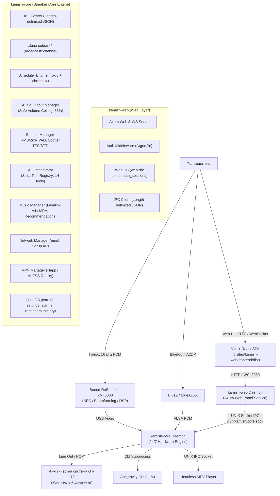

# Архитектура автономной умной колонки «Камыш» (Kamish)

## 1. Концепция и парадигма

Kamish представляет собой встраиваемый автономный программно-аппаратный комплекс на базе вычислительного модуля Orange Pi 4 Pro (Allwinner A733, ARM64), микрофонного массива Seeed ReSpeaker XVF3800 и акустической системы GT-112.

Система спроектирована по парадигме **Offline-First**:
- Все функции, способные выполняться локально (будильники, напоминания, воспроизведение сохранённой музыки, синтез предупреждающих тонов, индикация состояния), не имеют зависимостей от внешних серверов или доступности глобального интернета.
- Доступ к внешним облачным сервисам (AI LLM, YouTube Music, VLESS VPN) является опциональным уровнем расширения возможностей.



---

## 2. Архитектура подсистем (Разделение процессов)

Архитектура системы разделена на два изолированных процесса и общую библиотеку протокола:
- **`kamish-core`** (`crates/kamish-core`): автономное ядро колонки, работающее 24/7. Владеет всем железом (аудио, микрофоны ReSpeaker XVF3800, Bluetooth, Wi-Fi/NetworkManager), локальным планировщиком задач (будильники, напоминания), синтезом речи (TTS/STT), музыкальным воспроизведением и локальной базой `core.db`. Слушает UNIX-сокет IPC `/run/kamish/core.sock`. Не имеет зависимостей от веб-сервера Axum.
- **`kamish-web`** (`crates/kamish-web`): легковесный веб-сервис панели управления. Предоставляет HTTP REST API (`/api/v1/*`), раздачу SPA статики с клиенто-ориентированным роутингом, WebSocket стриминг событий, авторизацию пользователей (Argon2id) и хранит сессии в изолированной `web.db`. Все действия над устройством проксирует в `kamish-core` через типизированный IPC-клиент. При перезапуске или недоступности ядра возвращает 503 `CORE_OFFLINE`.
- **`kamish-ipc`** (`crates/kamish-ipc`): общая библиотека протокола взаимодействия между `kamish-web` и `kamish-core`. Реализует строго типизированные сообщения (`CoreRequest`, `CoreResponse`, `CoreEvent`), кадрирование через длину (length-delimited JSON framing), а также сервер и клиент на базе `tokio::net::UnixStream`.

### 2.1. kamish-core Daemon (`crates/kamish-core/src/`)
- **Tokio Runtime**: многопоточный асинхронный планировщик задач.
- **IPC Server**: обработчик входящих команд от `kamish-web` через сокет `/run/kamish/core.sock`.
- **SQLx + SQLite**: реляционная база данных ядра в режиме WAL (`core.db`). Схема `database/schema.sql` содержит таблицы настроек, будильников, напоминаний, сессий ИИ и истории музыки.
- **Шина событий (Event Bus)**: централизованный `broadcast::channel`, рассылающий системные события (`CoreEvent`), которые транслируются клиентам IPC и далее в WebSockets.

### 2.2. AI Orchestrator & Tool Registry (`crates/kamish-core/src/ai/`)
Языковая модель работает в условиях строгой изоляции:
1. Модель не имеет доступа к shell, файловой системе или приватным ключам.
2. Все действия выполняются через строго типизированный реестр **Tool Registry** (14 инструментов).
3. При сбое инструмента (`ToolCallResult.success = false`) AI-клиент формирует прозрачный ответ с сообщением об ошибке без галлюцинаций успешного выполнения.
4. Предусмотрен `MockAiClient` для работы в оффлайн-режиме без запуска Antigravity CLI.

### 2.3. Speech Subsystem (`crates/kamish-core/src/speech/`)
1. **VAD (Voice Activity Detector)**: чистая реализация на Rust по среднеквадратичной амплитуде (RMS) и частоте пересечения нуля (ZCR) с динамическим порогом и алгоритмом сглаживания hangover.
2. **Wake Word Spotter**: автономный детектор активационных фраз («ассистент», «колонка», «слушай»).
3. **STT / TTS Abstraction**: унифицированные трейты с поддержкой как локальных движков (Vosk, Sherpa-onnx, Piper, RHVoice), так и встроенного оффлайн WAV-синтезатора системных оповещений.
4. **Audio Capture Loop** (`crates/kamish-core/src/speech/capture/`): единственный компонент, который реально читает микрофон.
   * `AudioSource` — object-safe трейт источника PCM-кадров (320 сэмплов i16 LE, 16 кГц, моно, ~20 мс).
   * `ArecordAudioSource` — реальный захват через `arecord` (ALSA) со стримингом raw PCM в stdout. Доступность строго проверяется: при отсутствии бинарника `is_available()` возвращает `false`.
   * `MockAudioSource` — детерминированный синтез кадров для x86_64/WSL и тестов; честно заявляет себя как mock и не имитирует физическое железо.
   * `CaptureLoop` — конвейер `кадры → VAD → wake word → сборка фразы → STT → AI → TTS`. Стартует **разоружённым**: слушает команду только после детекции активационной фразы, после каждой фразы разоружается снова.
   * `CaptureSupervisor` — владеет жизненным циклом фоновой задачи (start/stop) и транслирует реальное состояние в `SpeechManager`, поэтому `microphone_available` / `microphone_listening` всегда отражают действительность, а не константу.

   Выбор источника: `KAMISH_AUDIO_SOURCE=arecord|mock`; устройство ALSA — `KAMISH_MIC_DEVICE` (по умолчанию `default`); автостарт при загрузке — `KAMISH_AUTOSTART_CAPTURE=1`; разрешение mock-микрофона без железа — `KAMISH_ALLOW_MOCK_MIC=1`.
5. **Локальные модели STT/TTS**: устанавливаются скриптом `scripts/install-local-models.sh` в `/opt/kamish-models`.
   * Piper TTS — нейросетевой синтез (`PIPER_BIN`, `PIPER_MODEL_PATH`), русский голос `ru_RU-dmitri-medium`.
   * Vosk STT — оффлайн-распознавание (`VOSK_MODEL_PATH`), модель `vosk-model-small-ru-0.22`.
   * Совместимость: `scripts/vosk-transcriber` — обёртка, которую ожидает `VoskSttProvider` (пакет `vosk` из pip не ставит такой бинарник).
   * Язык конвейера — `KAMISH_SPEECH_LANG` (по умолчанию `ru`).

### 2.3.1. Управление Antigravity CLI (`crates/kamish-core/src/ai/agy_manager.rs`)

CLI `agy` не входит в поставку: он проприетарный, скачивается по запросу и авторизуется
владельцем. Модуль закрывает весь цикл из веб-панели:

1. **`status()`** — установлен ли бинарник, версия, признак авторизации, архитектура.
2. **`install()`** — скачивание релиза под текущую архитектуру. Разрешены только `http(s)`,
   размер ограничен 200 МБ, каталог установки фиксирован (`KAMISH_AGY_DIR`).
3. **`begin_login()`** — запуск авторизации; из вывода CLI извлекаются ссылка и одноразовый код.
4. **`submit_code()`** — передача кода из панели обратно в CLI.

Токены и переменные окружения CLI никогда не попадают в ответы API. Для сборок без
сети есть `scripts/fetch-agy.sh`, который вызывается на этапе сборки ядра и молча
пропускается, если адрес загрузки не задан.

### 2.4. Music Subsystem (`crates/kamish-core/src/music/`)
1. **Музыкальный сервер Lavalink v4 / MPV**: переход на Lavalink v4 с плагином `LavaSrc` (ADR-010) для поддержки мультисервисного воспроизведения (YouTube Music, Yandex Music, SoundCloud, Spotify). Для локального аудио и тестов используется headless MPV через UNIX-сокет IPC (`/tmp/mpv-kamish.sock`) с виртуальным mock-драйвером.
2. **Музыкальные рекомендации**: получение рекомендаций делегировано исключительно на сторону сервиса YouTube Music (без локального скоринга).
3. **Каталог радио**: встроенные и настраиваемые потоки интернет-вещания.

### 2.5. Audio Output Manager & Hardware Safety (`crates/kamish-core/src/audio/`)
1. **Safe Volume Ceiling**: программное ограничение громкости (по умолчанию 85%) для предотвращения клиппинга усилителя GT-112 и повреждения катушек динамиков при питании 5V 3A.
2. **Audio Routing**: динамическое переключение между выходом GT-112 Line Out, беспроводным Bluetooth Sink, разъёмом для наушников и системным фоллбэком.

### 2.6. System Integration (`crates/kamish-core/src/bluetooth/`, `crates/kamish-core/src/network/`, `crates/kamish-core/src/vpn/`)
1. **BlueZ Controller**: управление A2DP Sink, сопряжение и режим обнаружения без блокировки рантайма.
2. **Network Manager**: интеграция с `nmcli`, сканирование сетей, подключение и режим точки доступа первичной настройки `kamish-setup` (192.168.4.1).
3. **Happ / VLESS Reality**: управление туннелем с обязательной маскировкой UUID, секретов и URL-подписок во всех логах и структурах `Debug`.

### 2.7. Подсистема аутентификации и сессий (`crates/kamish-web/src/auth/`)
1. **Хэширование паролей**: Использует **Argon2id** с настраиваемыми параметрами сложности (память, итерации, параллелизм). Пароли никогда не сохраняются в открытом виде.
2. **Хранилище пользователей и сессий**:
   - `users`: идентификатор, логин, хэш пароля, флаг обязательной смены пароля `must_change_password`, временные метки.
   - `auth_sessions`: токен сессии (UUID v4), user_id, временные метки создания и истечения (TTL 7 суток).
3. **Axum Middleware (`auth_middleware`)**:
   - Защищает все маршруты `/api/v1/*`.
   - Белый список без авторизации: публичный статус `GET /api/v1/status` и вход `POST /api/v1/auth/login`.
   - Автоматическое извлечение токена из Cookie `kamish_session`, заголовков `Authorization: Bearer` и `X-Session-Token`, а также query-параметра `?token=`.
   - При активном флаге `must_change_password = true` возвращает код **403 Forbidden** (`code: PASSWORD_CHANGE_REQUIRED`) для всех запросов, кроме смены пароля (`/api/v1/auth/change-password`), проверки сессии и выхода.

### 2.8. Мастер первоначальной настройки и мониторинг деградации (`crates/kamish-core/src/setup/`)
1. **Координация запуска (Setup Wizard)**:
   - Отслеживает прохождение обязательных этапов: `network` (подключение Wi-Fi), `audio` (настройка громкости с Safe Ceiling $\le 85\%$), `voice` (диагностика микрофона и офлайн STT/TTS), `ai` (проверка готовности Antigravity CLI).
   - Этап `auth` (смена дефолтного пароля `admin`) автоматически помечается завершённым при вызове `/api/v1/auth/change-password`.
2. **Персистентность в `device_state`**:
   - Хранит состояние мастера в реляционной таблице `device_state` (`setup:completed`, `setup:step:<name>`, `setup:completed_at`).
3. **Диагностические пробы (`DiagnosticsService`)**:
   - Выполняет неблокирующий асинхронный опрос подсистем (сеть, аудио, речь, ИИ).
   - Формирует список деградированных компонентов (`degraded_components`) со ссылками на шаги восстановления.
4. **WebSocket-уведомления**:
   - Эмитит события `setup_step_updated` и `setup_completed` в общую шину событий при изменении прогресса.

---

## 3. Структура репозитория

```
kamish-os/
├── Cargo.toml                # Корневой Cargo Workspace
├── crates/
│   ├── kamish-ipc/           # Общая библиотека IPC протокола (Length-delimited JSON framing, IpcClient / IpcServer)
│   ├── kamish-core/          # Автономный демон ядра колонки (24/7, аппаратный слой, аудио, речь, планировщик, core.db)
│   │   ├── src/
│   │   │   ├── ai/           # AI Orchestrator, Antigravity CLI клиент, Mock клиент, 14 Tools
│   │   │   ├── audio/        # OutputManager, Safe Ceiling (<=85%), Alert tone гонг
│   │   │   ├── bluetooth/    # BlueZ / bluetoothctl контроллер
│   │   │   ├── config/       # Настройки окружения ядра
│   │   │   ├── database/     # SQLite WAL пул, schema.sql
│   │   │   ├── music/        # Lavalink v4 / MPV контроллер, радио, рекомендации
│   │   │   ├── network/      # Wi-Fi сканер, подключение, Setup AP
│   │   │   ├── scheduler/    # Планировщик будильников/напоминаний, chrono-tz
│   │   │   ├── speech/       # VAD, WakeWord, STT, TTS, capture pipeline
│   │   │   ├── system/       # Аппаратная телеметрия, сенсоры процессора, ReSpeaker
│   │   │   └── vpn/          # VLESS Reality менеджер с маскированием
│   │   └── tests/            # Интеграционные тесты ядра (telemetry, scheduler, speech, pipeline)
│   └── kamish-web/           # Сервис веб-панели (Axum :8080, Argon2id auth, web.db, IPC proxying)
│       ├── src/
│       │   ├── api/          # Axum REST обработчики, раздача статики SPA, WS стриминг
│       │   ├── auth/         # Аутентификация, сессии, Argon2id, web.db репозиторий
│       │   └── state.rs      # WebState с IpcClient для проксирования в kamish-core
│       └── frontend/         # Клиентская веб-панель (React 19, TypeScript, Vite, Tailwind CSS)
│           ├── package.json
│           ├── index.html
│           ├── src/
│           │   ├── api/      # Строго типизированный API-клиент ко всем эндпоинтам
│           │   ├── components/ # UI компоненты (Navbar, Card, Modal, AiAssistant и др.)
│           │   ├── pages/    # Dashboard, Music, Alarms, Diagnostics, Settings, Setup
│           │   └── types/    # TypeScript контракты моделей данных
│           └── dist/         # Скомпилированный статический бандл (раздаётся Axum)
├── database/                 # База данных SQLite
│   └── schema.sql            # Единая схема БД (таблицы, индексы, PRAGMA user_version)
├── deploy/                   # Диагностические скрипты, конфигурации и правила устройств
│   ├── lavalink/             # Скрипты и конфигурация Lavalink v4 / LavaSrc
│   ├── scripts/
│   │   └── hardware_check.sh # Автономная диагностика периферии и звука
│   └── systemd/              # Systemd сервисы (kamish-core.service, kamish-web.service, kamish.service)
├── firmware/                 # Сборка прошивки Kamish Linux (Buildroot) и OTA-пакетов
│   ├── buildroot-external-kamish/ # Внешнее дерево пакетов и настроек Buildroot
│   ├── scripts/              # Скрипты сборки образа (build-firmware.sh) и генерации ключей
│   └── Dockerfile            # Воспроизводимое окружение сборки прошивки
├── docs/                     # Полный комплект технической документации
│   ├── AGENT_PLAYBOOK.md     # Инструкция и грабли рабочего процесса для агентов
│   ├── API.md                # Полная спецификация всех REST и WS эндпоинтов
│   ├── ARCHITECTURE.md       # Подробная архитектура монолита и подсистем
│   ├── CODE_TASKS.md         # Очередь задач по модификации кодовой базы
│   ├── DECISIONS.md          # Журнал архитектурных решений (ADR)
│   ├── HARDWARE.md           # Электрическая схема, питание, протокол GT-112
│   ├── ROADMAP.md            # Дорожная карта и прогресс этапов разработки
│   ├── SECURITY.md           # Модель угроз и правила безопасности
│   └── SPECIFICATION.md      # Технические характеристики и требования SLA
├── AGENTS.md                 # Правила разработки и технические регламенты
└── README.md                 # Общее описание проекта и быстрый старт
```

---

## 4. Модель безопасности

1. **Принцип наименьших привилегий**:
   - Службы `kamish-core.service` и `kamish-web.service` выполняются от пользователя `kamish` с ограничениями `ProtectSystem=strict`, `ProtectHome=true`, `PrivateTmp=true`, `NoNewPrivileges=true`. Ядро `kamish-core` получает доступ к звуковым устройствам и сетевым возможностям (`CAP_NET_BIND_SERVICE CAP_NET_ADMIN CAP_SYS_NICE`), тогда как веб-интерфейс `kamish-web` изолирован от прямого доступа к оборудованию.
2. **Аутентификация и контроль паролей**:
   - Защита сессионными куками `HttpOnly` и токенами на всех бизнес-маршрутах.
   - Принудительная блокировка доступа до смены дефолтного пароля администратора.
3. **Границы облака и приватность речи**:
   - Запрет на облачные провайдеры для распознавания (STT) и синтеза (TTS) речи. Микрофонный поток и синтезированные ответы обрабатываются строго локально на устройстве.
   - Внешняя модель ИИ вызывается через дочерний процесс Antigravity CLI (`agy`), сетевое взаимодействие которого ограничено его собственной песочницей.
4. **Изоляция секретов**:
   - Пароли Wi-Fi и параметры VPN никогда не возвращаются в ответах API и не логируются в `tracing`.
5. **Безопасность тестов**:
   - Автоматическое распознавание тестового раннера глушит физический аудиовыход в тестах (`set_audio_muted(true)`), защищая оборудование разработчика.
