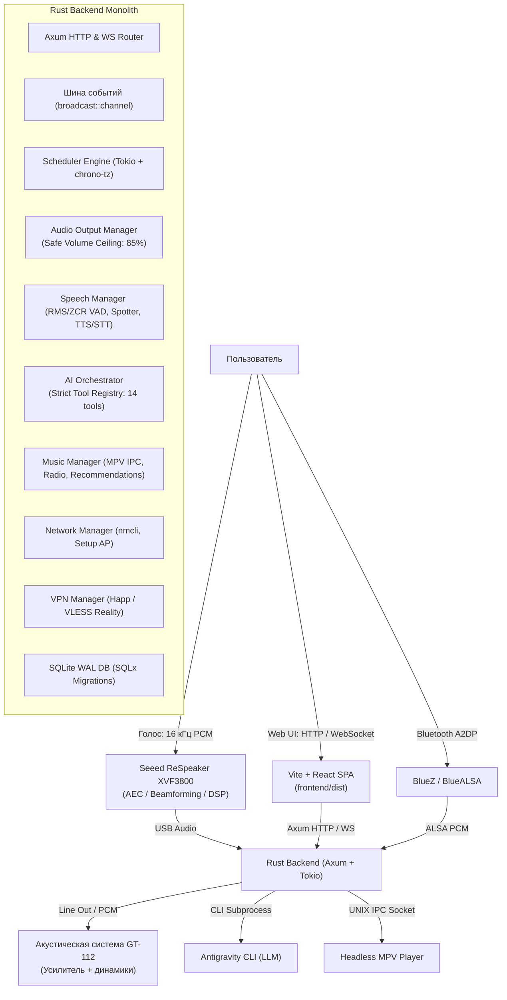

# Архитектура автономной умной колонки Smart Speaker

## 1. Концепция и парадигма

Smart Speaker представляет собой встраиваемый автономный программно-аппаратный комплекс на базе процессора Allwinner H618 (Orange Pi Zero 3, ARM64), микрофонного массива Seeed ReSpeaker XVF3800 и акустической системы GT-112.

Система спроектирована по парадигме **Offline-First**:
- Все функции, способные выполняться локально (будильники, напоминания, воспроизведение сохранённой музыки, синтез предупреждающих тонов, индикация состояния), не имеют зависимостей от внешних серверов или доступности глобального интернета.
- Доступ к внешним облачным сервисам (AI LLM, YouTube Music, VLESS VPN) является опциональным уровнем расширения возможностей.

---

## 2. Архитектура подсистем

### 2.1. Backend Core (`backend/src/`)
- **Tokio Runtime**: многопоточный асинхронный планировщик задач.
- **Axum Web Framework**: HTTP-сервер, раздающий как REST API (`/api/v1/*`), так и скомпилированный фронтенд через `tower_http::services::ServeDir` с авто-фоллбэком на `index.html`.
- **SQLx + SQLite**: реляционная база данных в режиме WAL (Write-Ahead Logging). Миграции скомпилированы непосредственно в исполняемый бинарный файл через `sqlx::migrate!("../database/migrations")`.
- **WebSocket Event Bus**: централизованный `broadcast::channel`, рассылающий системные события (`AlarmFired`, `AlarmToggled`, `ReminderTriggered`, `MusicTrackChanged`, `VolumeChanged`, `HardwareWarning`) подключенным клиентам.

### 2.2. AI Orchestrator & Tool Registry (`backend/src/ai/`)
Языковая модель работает в условиях строгой изоляции:
1. Модель не имеет доступа к shell, файловой системе или приватным ключам.
2. Все действия выполняются через строго типизированный реестр **Tool Registry** (14 инструментов).
3. При сбое инструмента (`ToolCallResult.success = false`) AI-клиент формирует прозрачный ответ с сообщением об ошибке без галлюцинаций успешного выполнения.
4. Предусмотрен `MockAiClient` для работы в оффлайн-режиме без запуска Antigravity CLI.

### 2.3. Speech Subsystem (`backend/src/speech/`)
1. **VAD (Voice Activity Detector)**: чистая реализация на Rust по среднеквадратичной амплитуде (RMS) и частоте пересечения нуля (ZCR) с динамическим порогом и алгоритмом сглаживания hangover.
2. **Wake Word Spotter**: автономный детектор активационных фраз («ассистент», «колонка», «слушай»).
3. **STT / TTS Abstraction**: унифицированные трейты с поддержкой как локальных движков (Vosk, Sherpa-onnx, Piper, RHVoice), так и встроенного оффлайн WAV-синтезатора системных оповещений.
4. **Audio Capture Loop** (`backend/src/speech/capture/`): единственный компонент, который реально читает микрофон.
   * `AudioSource` — object-safe трейт источника PCM-кадров (320 сэмплов i16 LE, 16 кГц, моно, ~20 мс).
   * `ArecordAudioSource` — реальный захват через `arecord` (ALSA) со стримингом raw PCM в stdout. Доступность строго проверяется: при отсутствии бинарника `is_available()` возвращает `false`.
   * `MockAudioSource` — детерминированный синтез кадров для x86_64/WSL и тестов; честно заявляет себя как mock и не имитирует физическое железо.
   * `CaptureLoop` — конвейер `кадры → VAD → wake word → сборка фразы → STT → AI → TTS`. Стартует **разоружённым**: слушает команду только после детекции активационной фразы, после каждой фразы разоружается снова.
   * `CaptureSupervisor` — владеет жизненным циклом фоновой задачи (start/stop) и транслирует реальное состояние в `SpeechManager`, поэтому `microphone_available` / `microphone_listening` всегда отражают действительность, а не константу.

   Выбор источника: `KAMISH_AUDIO_SOURCE=arecord|mock`; устройство ALSA — `KAMISH_MIC_DEVICE` (по умолчанию `default`); автостарт при загрузке — `KAMISH_AUTOSTART_CAPTURE=1`; разрешение mock-микрофона без железа — `KAMISH_ALLOW_MOCK_MIC=1`.
5. **Локальные модели STT/TTS**: устанавливаются скриптом `scripts/install-local-models.sh` в `/opt/kamish-models`.
   * Piper TTS — нейросетевой синтез (`PIPER_BIN`, `PIPER_MODEL_PATH`), русский голос `ru_RU-dmitri-medium`.
   * Vosk STT — оффлайн-распознавание (`VOSK_MODEL_PATH`), модель `vosk-model-small-ru-0.22`.
   * Совместимость: `scripts/vosk-transcriber` — обёртка, которую ожидает `VoskSttProvider` (пакет `vosk` из pip не ставит такой бинарник).
   * Язык конвейера — `KAMISH_SPEECH_LANG` (по умолчанию `ru`).

### 2.3.1. Управление Antigravity CLI (`backend/src/ai/agy_manager.rs`)

CLI `agy` не входит в поставку: он проприетарный, скачивается по запросу и авторизуется
владельцем. Модуль закрывает весь цикл из веб-панели:

1. **`status()`** — установлен ли бинарник, версия, признак авторизации, архитектура.
2. **`install()`** — скачивание релиза под текущую архитектуру. Разрешены только `http(s)`,
   размер ограничен 200 МБ, каталог установки фиксирован (`KAMISH_AGY_DIR`).
3. **`begin_login()`** — запуск авторизации; из вывода CLI извлекаются ссылка и одноразовый код.
4. **`submit_code()`** — передача кода из панели обратно в CLI.

Токены и переменные окружения CLI никогда не попадают в ответы API. Для сборок без
сети есть `scripts/fetch-agy.sh`, который вызывается на этапе сборки ядра и молча
пропускается, если адрес загрузки не задан.

### 2.4. Music Subsystem (`backend/src/music/`)
1. **Headless MPV**: управление плеером через UNIX-сокет IPC (`/tmp/mpv-smart-speaker.sock`) с автоматическим переходом на виртуальный плеер в тестовом окружении.
2. **Recommendation Engine**: локальный алгоритм скоринга треков на основе истории прослушиваний, количества лайков и штрафов за пропуск на первых секундах.
3. **Каталог радио**: встроенные и настраиваемые потоки интернет-вещания.

### 2.5. Audio Output Manager & Hardware Safety (`backend/src/audio/`)
1. **Safe Volume Ceiling**: программное ограничение громкости (по умолчанию 85%) для предотвращения клиппинга усилителя GT-112 и повреждения катушек динамиков при питании 5V 3A.
2. **Audio Routing**: динамическое переключение между выходом GT-112 Line Out, беспроводным Bluetooth Sink, разъёмом для наушников и системным фоллбэком.

### 2.6. System Integration (`backend/src/bluetooth/`, `network/`, `vpn/`)
1. **BlueZ Controller**: управление A2DP Sink, сопряжение и режим обнаружения без блокировки рантайма.
2. **Network Manager**: интеграция с `nmcli`, сканирование сетей, подключение и режим точки доступа первичной настройки `SmartSpeaker-Setup` (192.168.4.1).
3. **Happ / VLESS Reality**: управление туннелем с обязательной маскировкой UUID, секретов и URL-подписок во всех логах и структурах `Debug`.

---

## 3. Модель безопасности

1. **Принцип наименьших привилегий**:
   - Служба `smart-speaker.service` выполняется с ограничениями `ProtectSystem=strict`, `ProtectHome=true`, `PrivateTmp=true`, `NoNewPrivileges=true`.
2. **Изоляция секретов**:
   - Пароли Wi-Fi и параметры VPN никогда не возвращаются в ответах API и не логируются в `tracing`.
3. **Безопасность тестов**:
   - Автоматическое распознавание тестового раннера глушит физический аудиовыход в тестах (`set_audio_muted(true)`), защищая оборудование разработчика.
